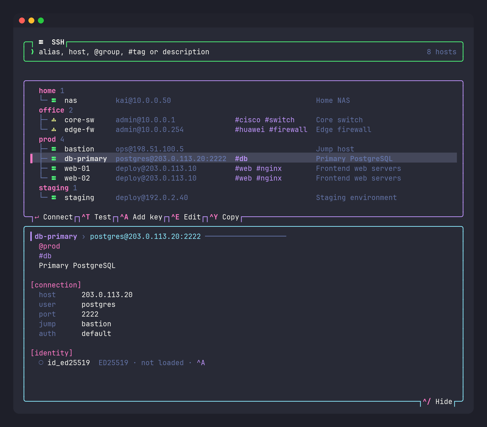

# zsh-remote

English | [简体中文](README.zh-CN.md)

Your SSH, SFTP, Telnet and FTP hosts in fzf pickers, read from ssh-config-style files, with a live preview, a connection test and one-key open. Plus an ssh-agent key manager and network device config backups.



| Command | What it does |
|---|---|
| `ssh-pick [query]` | Pick a host from `~/.ssh/config` (and its `Include`s), connect with `ssh-to` |
| `ssh-to <alias> [ssh options]` | ssh highlighted by [tinge](https://github.com/iskerwin/tinge), which picks its rule set from the host and its `#_Tags` (see the rule sets' `match`); plain ssh if tinge is missing |
| `sftp-pick` · `sftp-open <alias>` | Browse an SSH host's files over SFTP in lftp; `--tui` opens two panes in mc |
| `telnet-pick` · `telnet-to <alias>` | Telnet devices from `~/.ssh/telnet_config` |
| `ftp-pick` · `ftp-open <alias>` | FTP / FTPS servers from `~/.ssh/ftp_config`, password in the keychain |
| `ssh-cfg` · `telnet-cfg` · `ftp-cfg` | Edit a host file (through `chezmoi edit --apply` when chezmoi manages it, else `$VISUAL` / `$EDITOR`); `^E` in a picker does the same |
| `remote-doctor` | Which helper tools are installed, and how to install the missing ones |
| `ssh-ag [status \| clear]` | Add and remove ssh-agent keys with fzf |
| `net-backup [alias\|@group...]` | Back up switch, router and firewall configs (Ruijie, Cisco, Huawei, H3C) over SSH or Telnet |

Every command answers `-h`. In a picker: `↵` open, `^T` test the connection, `^E` edit the config file, `^Y` copy the alias, `^O` two-pane browser (SFTP / FTP), `^A` add the host's keys to ssh-agent (SSH), `^/` toggle the preview. `ssh \<Tab>` and friends open the picker as completion.

## Requirements

zsh 5.8+ and OpenSSH. Everything else is optional, and a command that needs a missing tool says so with the install command for your system (Homebrew, apt or dnf):

| Tool | Used for | Without it |
|---|---|---|
| [fzf](https://github.com/junegunn/fzf) 0.58+ | the pickers | open hosts directly: `ssh-to <alias>`, `ftp-open <alias>`, … |
| [tinge](https://github.com/iskerwin/tinge) 0.3+ | highlighting in `ssh-to` / `telnet-to` | plain ssh / telnet, with a one-time tip (or an upgrade warning for an older tinge) |
| `lftp` | `sftp-open`, `ftp-open` | `sftp-open` uses sftp (one-time tip); `ftp-open` stops with the install command |
| `mc` | two-pane browser (`^O`, `--tui`) | error with the install command |
| `telnet` | `telnet-to`, Telnet devices in `net-backup` | error with the install command (macOS no longer ships it) |
| `expect` | `net-backup` | error with the install command |
| `nc` | `^T` banner for Telnet / FTP | the port check uses zsh's built-in TCP module |
| `secret-tool` (Linux) | saved FTP / `net-backup` passwords | asked every time |

Run `remote-doctor` to see which are installed and how to get the rest. Set `REMOTE_TIPS=0` to hide the one-time tips. A [Nerd Font](https://www.nerdfonts.com/) shows the host icons.

Install [zsh-ui](https://github.com/iskerwin/zsh-ui) for the same TUI-style look as your other tools; without it zsh-remote uses a plain built-in look.

## Install

**Homebrew**

```sh
brew install iskerwin/tap/zsh-remote
echo 'source "$(brew --prefix)/share/zsh-remote/zsh-remote.plugin.zsh"' >> ~/.zshrc
```

**[zap](https://github.com/zap-zsh/zap)**

```zsh
plug "iskerwin/zsh-remote"
```

**Manual**

```sh
git clone https://github.com/iskerwin/zsh-remote ~/.local/share/zsh-remote
echo 'source ~/.local/share/zsh-remote/zsh-remote.plugin.zsh' >> ~/.zshrc
```

### Load order

Load it after `compinit`: the commands register their completions with `compdef`. zsh-ui can load before or after it. With the other tools:

```zsh
plug "iskerwin/zsh-ui"                      # 1. anywhere; first is simplest
plug "zap-zsh/supercharge"                  # 2. compinit (or your own compinit call)
plug "iskerwin/zsh-remote"                  # 3. after compinit
CF_PATHS=( ~/.zshrc ~/.config/zsh ${ZSH_REMOTE_DIR-} )
plug "iskerwin/command-finder"              # 4. after zsh-remote, so CF_PATHS can list its commands
plug "zsh-users/zsh-syntax-highlighting"    # 5. widget-wrapping plugins last
```

## Host files

All three files use ssh config syntax. Telnet and FTP hosts live in their own files, which you should **not** `Include` from `~/.ssh/config`, so ssh never sees them.

```sshconfig
Host core-sw
    HostName 10.0.0.1
    User admin
    #_Desc Core switch
    #_Tags ruijie, switch
    #_Group site-a
```

- `#_Desc`, `#_Tags`, `#_Group` show in the list and are searchable (`@site-a`, `#switch`). `ssh-to` also hands `#_Tags` to tinge (`--tags`), whose rule sets choose by them: tag devices `switch`, `router` or `firewall`.
- In `~/.ssh/ftp_config`, `#_Proto ftps` means implicit TLS (port 990); without it, plain FTP that lftp upgrades to TLS when offered. No `User` means anonymous.
- Telnet and FTP default to ports 23 and 21 when there is no `Port`.

## Passwords

FTP and net-backup passwords are kept in the macOS Keychain (`security`) or, on Linux, the Secret Service (`secret-tool`); without either, you are asked each time. They are never put in command arguments. `ftp-open --forget <alias>` and `net-backup --forget <alias>` delete a saved one.

## net-backup

Devices are the hosts whose alias or `#_Tags` contain ruijie, cisco, huawei, h3c, switch, router, firewall or network. The vendor is recognized from the prompt after login; paging is turned off and the running config saved to `~/Backups/network/<alias>/<alias>_<time>.txt` (owner-only). An incomplete capture is kept as `.incomplete` instead. The first backup of a device asks for its password; an enable / super password that differs is saved under `<alias>:enable`. New host keys are never accepted automatically: ssh to a device once first.

## Configuration

| Variable | Default |
|---|---|
| `REMOTE_SSH_CONFIG` | `~/.ssh/config` (where the SSH list is read; ssh itself still reads its usual config) |
| `REMOTE_TELNET_CONFIG` | `~/.ssh/telnet_config` |
| `REMOTE_FTP_CONFIG` | `~/.ssh/ftp_config` |
| `REMOTE_CONNECT_TIMEOUT` | `3` seconds for `^T` |
| `REMOTE_PREVIEW_WIDTH` | `55` (% of the picker) |
| `REMOTE_CLIP` | first of `clip-copy`, `pbcopy`, `wl-copy`, `xclip`, `xsel` |
| `NET_BACKUP_DIR` | `~/Backups/network` |
| `REMOTE_TIPS` | `1`; `0` hides the one-time tips about optional tools |

## Development

```sh
zsh -f tests.zsh && zsh -f tests-lib.zsh
```

The tests use fake `ssh`, `lftp`, `fzf` and keychain commands, and drive the real Expect script against a fake device; nothing touches the network or real credentials.

## License

[MIT](LICENSE)
