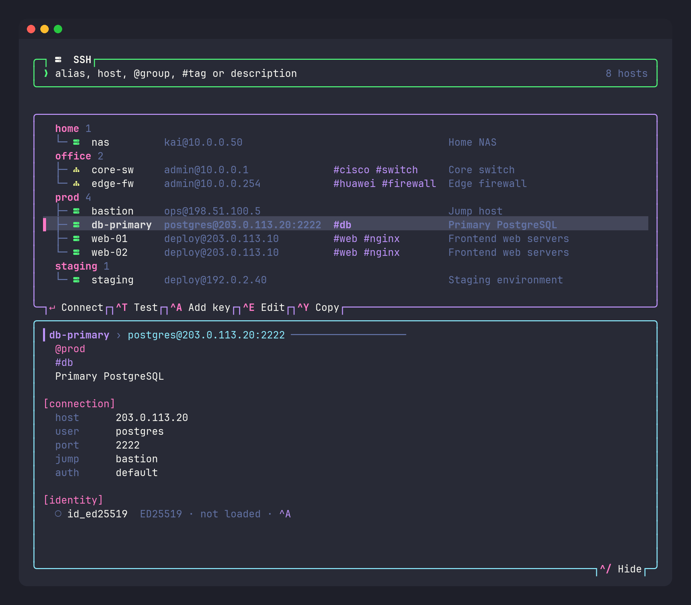

# zsh-remote

[English](README.md) | 简体中文

把你的 SSH、SFTP、Telnet 和 FTP 主机放进 fzf 选择器：从 ssh config 格式的文件读取，带实时预览、连通性测试和一键打开。另有 ssh-agent 密钥管理和网络设备配置备份。



| 命令 | 作用 |
|---|---|
| `ssh-pick [查询]` | 从 `~/.ssh/config`（及其 `Include`）中选择主机，用 `ssh-to` 连接 |
| `ssh-to <别名> [ssh 选项]` | 由 [tinge](https://github.com/iskerwin/tinge) 高亮的 ssh，tinge 根据主机及其 `#_Tags` 选择规则集（见规则集的 `match`）；没有 tinge 时为普通 ssh |
| `sftp-pick` · `sftp-open <别名>` | 在 lftp 中通过 SFTP 浏览 SSH 主机的文件；`--tui` 用 mc 打开左右两栏 |
| `telnet-pick` · `telnet-to <别名>` | `~/.ssh/telnet_config` 中的 Telnet 设备 |
| `ftp-pick` · `ftp-open <别名>` | `~/.ssh/ftp_config` 中的 FTP / FTPS 服务器，密码存在钥匙串 |
| `ssh-cfg` · `telnet-cfg` · `ftp-cfg` | 编辑主机文件（由 chezmoi 管理时用 `chezmoi edit --apply`，否则用 `$VISUAL` / `$EDITOR`）；选择器里按 `^E` 效果相同 |
| `remote-doctor` | 列出已安装的辅助工具，以及缺失工具的安装方法 |
| `ssh-ag [status \| clear]` | 用 fzf 添加和移除 ssh-agent 中的密钥 |
| `net-backup [别名\|@分组...]` | 通过 SSH 或 Telnet 备份交换机、路由器和防火墙的配置（锐捷、思科、华为、H3C） |

每个命令都支持 `-h`。选择器中：`↵` 打开，`^T` 测试连接，`^E` 编辑配置文件，`^Y` 复制别名，`^O` 两栏文件管理器（SFTP / FTP），`^A` 把主机的密钥加入 ssh-agent（SSH），`^/` 显示或隐藏预览。`ssh \<Tab>` 等补全会打开选择器。

## 依赖

zsh 5.8+ 和 OpenSSH。其余都是可选的；需要某个缺失工具的命令会提示，并给出适合你系统的安装命令（Homebrew、apt 或 dnf）：

| 工具 | 用途 | 没有时 |
|---|---|---|
| [fzf](https://github.com/junegunn/fzf) 0.58+ | 选择器 | 直接打开主机：`ssh-to <别名>`、`ftp-open <别名>` 等 |
| [tinge](https://github.com/iskerwin/tinge) 0.3+ | `ssh-to` / `telnet-to` 的高亮 | 普通 ssh / telnet，并给出一次性提示（tinge 版本过旧时提示升级） |
| `lftp` | `sftp-open`、`ftp-open` | `sftp-open` 改用 sftp（一次性提示）；`ftp-open` 停止并给出安装命令 |
| `mc` | 两栏文件管理器（`^O`、`--tui`） | 报错并给出安装命令 |
| `telnet` | `telnet-to`，以及 `net-backup` 中的 Telnet 设备 | 报错并给出安装命令（macOS 已不再自带） |
| `expect` | `net-backup` | 报错并给出安装命令 |
| `nc` | Telnet / FTP 的 `^T` banner | 端口检测改用 zsh 内置的 TCP 模块 |
| `secret-tool`（Linux） | 保存 FTP / `net-backup` 的密码 | 每次询问 |

运行 `remote-doctor` 查看哪些已安装、其余怎么装。设置 `REMOTE_TIPS=0` 隐藏一次性提示。装了 [Nerd Font](https://www.nerdfonts.com/) 才能显示主机图标。

安装 [zsh-ui](https://github.com/iskerwin/zsh-ui)，就能和你的其他工具一样使用 TUI 风格；没有它时 zsh-remote 使用朴素的内置样式。

## 安装

**Homebrew**

```sh
brew install iskerwin/tap/zsh-remote
echo 'source "$(brew --prefix)/share/zsh-remote/zsh-remote.plugin.zsh"' >> ~/.zshrc
```

**[zap](https://github.com/zap-zsh/zap)**

```zsh
plug "iskerwin/zsh-remote"
```

**手动**

```sh
git clone https://github.com/iskerwin/zsh-remote ~/.local/share/zsh-remote
echo 'source ~/.local/share/zsh-remote/zsh-remote.plugin.zsh' >> ~/.zshrc
```

### 加载顺序

在 `compinit` 之后加载：各命令用 `compdef` 注册补全。zsh-ui 放在它之前或之后都行。与其他工具一起：

```zsh
plug "iskerwin/zsh-ui"                      # 1. 任意位置；放最前最简单
plug "zap-zsh/supercharge"                  # 2. compinit（或你自己的 compinit 调用）
plug "iskerwin/zsh-remote"                  # 3. 在 compinit 之后
CF_PATHS=( ~/.zshrc ~/.config/zsh ${ZSH_REMOTE_DIR-} )
plug "iskerwin/command-finder"              # 4. 在 zsh-remote 之后，CF_PATHS 才能列出它的命令
plug "zsh-users/zsh-syntax-highlighting"    # 5. 包装 widget 的插件放最后
```

## 主机文件

三个文件都使用 ssh config 语法。Telnet 和 FTP 主机放在各自的文件里，**不要**从 `~/.ssh/config` 中 `Include` 它们，这样 ssh 永远看不到。

```sshconfig
Host core-sw
    HostName 10.0.0.1
    User admin
    #_Desc Core switch
    #_Tags ruijie, switch
    #_Group site-a
```

- `#_Desc`、`#_Tags`、`#_Group` 显示在列表中，并且可以搜索（`@site-a`、`#switch`）。`ssh-to` 还会把 `#_Tags` 交给 tinge（`--tags`），tinge 的规则集据此选择：给设备打上 `switch`、`router` 或 `firewall` 标签。
- 在 `~/.ssh/ftp_config` 中，`#_Proto ftps` 表示隐式 TLS（端口 990）；不写则为普通 FTP，服务器支持时 lftp 会升级到 TLS。没有 `User` 表示匿名登录。
- 没有 `Port` 时，Telnet 和 FTP 默认分别为 23 和 21。

## 密码

FTP 和 net-backup 的密码保存在 macOS 钥匙串（`security`）中，Linux 上保存在 Secret Service（`secret-tool`）中；两者都没有时每次询问。密码从不放在命令参数里。`ftp-open --forget <别名>` 和 `net-backup --forget <别名>` 删除已保存的密码。

## net-backup

别名或 `#_Tags` 中包含 ruijie、cisco、huawei、h3c、switch、router、firewall 或 network 的主机视为网络设备。登录后根据提示符识别厂商，关闭分页，把当前运行配置保存到 `~/Backups/network/<别名>/<别名>_<时间>.txt`（仅属主可读写）。抓取不完整时改为保存为 `.incomplete`。首次备份某台设备时会询问密码；与登录密码不同的 enable / super 密码保存在 `<别名>:enable` 下。从不自动接受新的主机密钥：请先手动 ssh 一次该设备。

## 配置

| 变量 | 默认值 |
|---|---|
| `REMOTE_SSH_CONFIG` | `~/.ssh/config`（读取 SSH 列表的位置；ssh 本身仍读取它通常的配置） |
| `REMOTE_TELNET_CONFIG` | `~/.ssh/telnet_config` |
| `REMOTE_FTP_CONFIG` | `~/.ssh/ftp_config` |
| `REMOTE_CONNECT_TIMEOUT` | `^T` 的超时，`3` 秒 |
| `REMOTE_PREVIEW_WIDTH` | `55`（占选择器的百分比） |
| `REMOTE_CLIP` | `clip-copy`、`pbcopy`、`wl-copy`、`xclip`、`xsel` 中第一个可用的 |
| `NET_BACKUP_DIR` | `~/Backups/network` |
| `REMOTE_TIPS` | `1`；`0` 隐藏关于可选工具的一次性提示 |

## 开发

```sh
zsh -f tests.zsh && zsh -f tests-lib.zsh
```

测试使用假的 `ssh`、`lftp`、`fzf` 和钥匙串命令，并让真实的 Expect 脚本对接一台假设备；不会访问网络，也不碰真实凭据。

CI 还会检查 `ui-fallback.zsh` 与 [zsh-ui](https://github.com/iskerwin/zsh-ui) 最新版本的同名文件完全一致。

## 许可证

[MIT](LICENSE)
